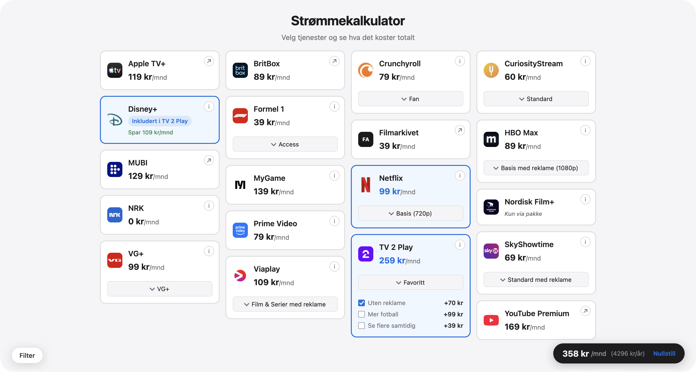

# Strømmekalkulator



Calculator for Norwegian streaming services. Pick services, tiers, and add-ons and see the monthly and yearly total.

Not affiliated with any of the providers. Prices are best-effort and may be out of date; always check with the provider before subscribing.

## Quick start

The page fetches `data.json` and `exchange-rate.json`, so open it through a static server rather than from `file://`:

```sh
python3 -m http.server
```

Then visit http://localhost:8000.

## About

Pick any combination of services for a monthly and yearly total, and filter by sport (football, winter sports, tennis, Formel 1, etc.). The current selection is encoded in the URL hash, so the link is shareable. It is vanilla HTML, CSS, and JS with no build step and no dependencies.

## Data

Prices live in `data.json`. Each service has a `lastChecked` date that I bump manually when I verify prices; the footer's "Sist oppdatert" label follows the most recent date across all services. Exchange rates for non-NOK prices live in `exchange-rate.json` and are refreshed monthly by a scheduled CI job.

Validate `data.json` before committing (CI runs the same check):

```sh
node scripts/validate.mjs
```

## Requirements

A browser and any static file server. Node is only needed for `scripts/validate.mjs`.
